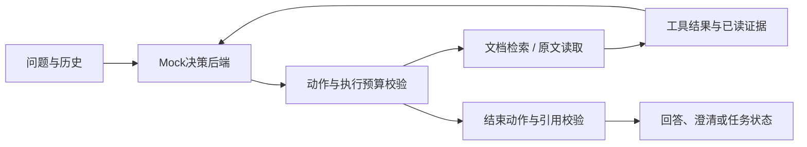

# 方案设计

## 调用流程

`cli.py`处理输入输出；`agent.py`维护状态、执行预算和引用校验；`tools.py`提供检索与读取；`mock_model.py`根据工具结果选择动作。

每轮后端接收问题、历史、工具观察和已读证据，返回`Action(name, arguments, reason)`。执行器调用对应工具，保存结果后进入下一轮。`finish`动作通过引用校验后结束任务。

## 工具接口

| 工具 | 输入 | 返回 |
|---|---|---|
| `search_documents` | `query`、可选`limit`（1至10） | 文档ID、标题、日期、范围、主题、摘要、分数和匹配总数 |
| `read_document` | `doc_id` | 文档元数据与完整原文片段 |

错误统一返回`ok: false`、错误代码、说明和可重试标志。故障注入参数可指定工具、文档和失败次数。

## 检索与冲突处理

资料库包含6份文档，采用中文双字片段与英文词匹配。标题和关键词交集权重为3，正文权重为1；同分时按文档ID排序。

对“住店/宾馆→住宿”“报账→报销”“无线网→wifi”进行同义词归一化。上下文用于确定追问对象，回答内容取自读取到的原文。

资料片段通过`topic`标识主题。Mock读取同主题候选，比较规范化原文；出现不同规定时同时引用并请求确认适用范围或优先级。

## 执行路径

1. 正常：检索住宿标准 → 读取D03 → 回答并引用原文。
2. 冲突：检索报销期限 → 读取D01、D02 → 列出30天和15天 → 请求确认。
3. 恢复：读取D03失败 → 根据可重试标志再次读取 → 成功后回答。
4. 资料不足：首次检索无结果 → 换用制度关键词 → 仍无结果 → 返回资料缺口。

Trace记录每一步的动作、参数、工具结果、下一动作及简要决策依据。

## 状态与校验

默认最多10轮决策、8次工具调用，可通过CLI调整。无效决策计入轮数，失败调用计入工具次数；达到上限时返回`incomplete`并保留已读文档ID。

相同工具及参数的可重试错误最多再试一次；不可重试错误直接结束。成功读取的资料保存在任务状态中。

引用校验检查文档是否已读取、片段ID是否存在、引用是否为原文子串；标题和版本日期取自工具返回。校验失败作为新观察交回决策后端。

## 技术取舍

使用Python标准库，便于直接运行和检查。小规模资料采用关键词检索，决策后端通过`DecisionBackend.decide(state) -> Action`与工具分离，后续可在该接口接入真实模型。
